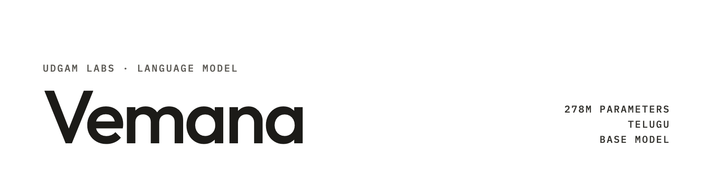

**UDGAM LABS** · Language model · 278M parameters, Telugu, base

# Vemana

Vemana by Udgam Labs is a 278M-parameter Telugu base language model, trained from scratch on 5.1 billion tokens of
public Telugu web text with its own 32,000-token Telugu tokenizer. On 416 Telugu Wikipedia pages created in September
and October 2026, it scores 0.361 bits per byte, against 0.383 for nanochat-telugu-560M, twice its size and the next
best open base model under 1 billion parameters that we tested (lower is better; same scoring script and pages for every
model; measured by Udgam Labs on 27 October 2026). It continues Telugu text; it does not follow instructions. It runs on
a laptop-class CPU. It is meant as a base for research and for building Telugu tools. This repository holds the code to
rebuild the test and score any model on it, and the release-gate results; the weights are on Hugging Face.

[Model card](https://huggingface.co/udgamlabs/Vemana-Base) · [Try it](https://huggingface.co/spaces/udgamlabs/Vemana) · [Every checkpoint](https://huggingface.co/udgamlabs/Vemana-Checkpoints) · [Technical report](https://udgamlabs.com/research/vemana) · [udgamlabs.com/models/vemana](https://udgamlabs.com/models/vemana) · [Trained live](https://udgamlabs.com/live/vemana)

## Get started

**Use the model** (from [`udgamlabs/Vemana-Base`](https://huggingface.co/udgamlabs/Vemana-Base)):

```python
from transformers import AutoTokenizer, AutoModelForCausalLM

tok = AutoTokenizer.from_pretrained("udgamlabs/Vemana-Base")
model = AutoModelForCausalLM.from_pretrained("udgamlabs/Vemana-Base")
inputs = tok("తెలుగు భాష", return_tensors="pt")   # the tokenizer adds <s>
out = model.generate(**inputs, max_new_tokens=80, do_sample=True, temperature=0.8, top_p=0.95)
print(tok.decode(out[0], skip_special_tokens=True))
```

Needs transformers 5.19 or newer (Gemma 4 text layout). Keep prompt and output within 1,024 tokens, the length it was
trained at (about 570 Telugu words). On a Mac mini's CPU it writes about 65 tokens per second.

**Run it on your own device:** in a web browser at [udgamlabs.com/models/vemana](https://udgamlabs.com/models/vemana#try) (the 297 MB model downloads once; text never leaves the device), or with llama.cpp from [udgamlabs/Vemana-Base-GGUF](https://huggingface.co/udgamlabs/Vemana-Base-GGUF):

```bash
llama-completion -hf udgamlabs/Vemana-Base-GGUF:Q8_0 -p "వర్షాకాలంలో" -n 80 --temp 0.8 --top-p 0.95 -c 1024
```

**Reproduce the main number** with the code in [`eval/`](./eval) (details and the other two sets in
[eval/README.md](./eval/README.md)):

```bash
pip install torch "transformers>=5.19" pyarrow huggingface_hub
cd eval
python build_te.py crawl --wiki-start 2026-09-01 --wiki-end 2026-10-22 --seed 20261023 \
    --cache-dir cache --raw-dir raw/te-2026-10 --out te-2026-10.crawl.jsonl
python build_te.py finalize te-2026-10.crawl.jsonl --out-dir te-2026-10
python score.py udgamlabs/Vemana-Base --data te-2026-10/data/test.parquet --ctx 1024 --out runs/vemana.json
python compare.py runs/other-model.json runs/vemana.json      # Vemana minus the other model, paired 95% interval
```

`build_te.py` fetches each page at its current revision, so a set rebuilt later can differ a little from ours (pages
edited or deleted since we built them on 23 and 27 October 2026).

**What is in this repository**

| Path | What it is |
|---|---|
| `eval/build_te.py` | Builds a fresh Telugu Wikipedia test set for any date range |
| `eval/score.py` | Bits per byte of any Hugging Face causal language model on a set (the scorer used for every number here) |
| `eval/compare.py` | Paired page bootstrap: the gap between two models and its 95% interval |
| `eval/make_nopunct.py` | The punctuation-free copy of a set used for one of the checks |
| `results/release-gate-2026-10-27.md` | The release-gate summary: every model, set, check and multiple-choice test |
| `results/fresh-text-2026-10-27.json` | The headline numbers per model and set, machine-readable |
| `gguf/` | Rebuilds and checks the GGUF files for llama.cpp ([udgamlabs/Vemana-Base-GGUF](https://huggingface.co/udgamlabs/Vemana-Base-GGUF)) |
| `browser/` | Runs Vemana inside a web page (llama.cpp as WebAssembly); the same engine as on udgamlabs.com |
| `docs/REPORT.pdf` | The technical report: data, tokenizer, model, training run, the test and its rules, every result, where it falls short ([web](https://udgamlabs.com/research/vemana)) |

The test texts are not included (Telugu Wikipedia is CC BY-SA 4.0); `build_te.py` rebuilds them.

## How it works

### The model

- A Telugu base language model, 278,214,144 parameters, in the Gemma 4 text layout (`Gemma4ForCausalLM`): 18 layers,
  width 1,024, 8 query and 2 key-value heads, full attention, tied embeddings.
- Its own 32,000-token Telugu tokenizer (SentencePiece BPE with byte fallback, so any text can be written), trained on
  Sangraha's human-verified Telugu text.
- Context: 1,024 tokens. The config allows 4,096, but it was never trained or tested beyond 1,024.

### How it was trained

- **Data:** public Telugu web text from three open datasets: Sangraha (AI4Bharat, its human-verified Telugu part),
  FineWeb-2 (Hugging Face) and HPLT 3.0. Filtered for Telugu script and length, near-duplicates removed across the
  three, and the main test set (te-2026-10) and the multiple-choice tests below removed from the training text. 5.1B
  unique tokens.
- **Run:** trained from scratch (random initialisation, no pretrained weights) for 12.0B token positions, so the data
  was read about 2.4 times, on one H100 in about 16 hours on 26-27 October 2026: about $69 of GPU time. It was trained
  live in public at [udgamlabs.com/live/vemana](https://udgamlabs.com/live/vemana).
- **Checkpoints:** every 10% of the run and the final model are in
  [Vemana-Checkpoints](https://huggingface.co/udgamlabs/Vemana-Checkpoints). The release model, the final checkpoint,
  was chosen in advance.

### The test

- **Fresh Telugu text, bits per byte.** The total bits the model needs for every token of every page, divided by the
  pages' total UTF-8 bytes. Lower is better. Bytes do not depend on the tokenizer, so models with different tokenizers
  can be compared.
- **Three sets of new Telugu Wikipedia pages**, built by one script with one rule set (`eval/build_te.py`): new
  mainspace pages only; no redirects, recreated pages, lists or bot-created pages; at least 120 words of prose; at least
  85% Telugu script; re-checked for deletion. No page is in two sets.

  | Set | Pages created | Pages | Bytes | Editors (top editor's pages) | Role |
  |---|---|---|---|---|---|
  | te-2026-10 | 1 Sep-22 Oct 2026 | 416 | 4,476,833 | 47 (150) | main test |
  | te-2026-10b | 23-26 Oct 2026 | 29 | 285,496 | 9 (16) | the newer set, fixed before training |
  | te-2026-summer | 1 Jul-31 Aug 2026 | 477 | 6,001,285 | 33 (210) | supplementary, larger |

- **Every compared model was released before these pages were written,** except Dhee-Pravega-OG Atom (released
  8 October 2026; its data sources and cut-off are not stated), so the July-August and early-September pages could be
  in its training data, which could only help it. The 23-26 October pages are after every model.
- **Scoring** (`eval/score.py`, unchanged for every model): float32 weights, TF32 matrix multiplies, a 1,024-token
  window (Goldfish 512, its limit) sliding by half a window, the model's BOS token first when it has one, every token
  scored once.
- **Intervals:** 95%, from 4,000 page resamples (seed 0). A **gap** is Vemana minus the other model on the same
  resampled pages: negative means Vemana is better.
- **Control:** in the release run, every model scored earlier reproduced its earlier per-page result on te-2026-10 with
  identical tokens: the five other models exactly, and Vemana within 6.7e-5 (relative) of its score from the same
  script at the end of training.
- **Rules fixed in advance:** we fixed the test, the win margin (0.02 bits per byte over the best open model under 1B)
  and the robustness checks (a 512-token window, without the top editor's pages, and the 23-26 October pages) before
  training. All passed.

## Results

**Vemana (278M) predicts new Telugu text better than any other open base model under 1 billion parameters that we
tested.** Bits per byte, lower is better; measured by Udgam Labs on 27 October 2026 with the scoring above. Every
interval and the full set of checks are in [results/release-gate-2026-10-27.md](./results/release-gate-2026-10-27.md).

**te-2026-10: 416 pages created in September-October 2026 (main test)**

| Model | Parameters | Licence | Bits per byte [95% CI] | Vemana minus model [95% CI] |
|---|---|---|---|---|
| **Vemana** | 278M | Apache-2.0 | **0.361** [0.353, 0.367] | — |
| nanochat-telugu-560M | 561M | AGPL-3.0 | 0.383 [0.376, 0.390] | **−0.022** [−0.024, −0.021] |
| Dhee-Pravega-OG Atom | 646M | Apache-2.0 at the scored revision | 0.393 [0.385, 0.400] | −0.032 [−0.034, −0.031] |
| Pothana Base v2 | 222M (370M with its shared blocks) | Apache-2.0 | 0.440 [0.433, 0.448]; 0.426 on the words its tokenizer covers | −0.080 [−0.081, −0.078]; against 0.426: −0.066 [−0.067, −0.064] |
| Pothana stage-a-plus | 230M unique | Apache-2.0 | 0.450; covered 0.436 | −0.090 [−0.092, −0.088] |
| Goldfish Telugu 1000mb | 125M | Apache-2.0 | 0.458 [0.450, 0.465] | −0.097 [−0.099, −0.095] |
| Pothana sp-base-300M | 387M unique | Apache-2.0 | 0.462 | −0.102 |
| Gemma-3-1B | 1.0B | Gemma Terms | 0.484 [0.474, 0.493] | −0.123 [−0.127, −0.119] |
| Qwen3.5-0.8B-Base | 0.87B | Apache-2.0 | 0.584 | −0.223 |
| Gemma-3-270m | 268M | Gemma Terms | 0.585 | −0.224 |
| Qwen3-0.6B-Base | 0.6B | Apache-2.0 | 0.692 | −0.332 |
| gpt-2-telugu1 | 98M | — | 0.786 | −0.425 |
| LFM2.5-230M-Base | 230M | LFM Open License | 1.709 | −1.348 |

Pothana Base v2's tokenizer turns about 3.6% of the bytes into an unknown-word token, so it never has to predict what
those bytes are; "covered" counts only the bytes it does predict, and we compare against that better number too.
Qwen3.5-0.8B, Gemma-3-270m, Qwen3-0.6B, gpt-2-telugu1, LFM2.5-230M, Pothana stage-a-plus and Pothana sp-base-300M were
scored on 23-25 October with the same script and pages; the others were scored on 27 October, and those scored before
reproduced their earlier per-page results (the control above).

**te-2026-10b: 29 pages created 23-26 October 2026 (after every model)**

| Model | Bits per byte [95% CI] | Vemana minus model [95% CI] |
|---|---|---|
| **Vemana** | **0.346** [0.311, 0.372] | — |
| nanochat-telugu-560M | 0.364 [0.330, 0.388] | −0.018 [−0.021, −0.015] |
| Dhee-Pravega-OG Atom | 0.371 [0.336, 0.397] | −0.025 [−0.030, −0.022] |
| Pothana Base v2 | 0.425; covered 0.410 | −0.079; against covered −0.065 [−0.074, −0.055] |
| Goldfish Telugu 1000mb | 0.435 | −0.090 [−0.097, −0.083] |
| Gemma-3-1B | 0.441 | −0.095 [−0.108, −0.080] |

**te-2026-summer: 477 pages created in July-August 2026 (supplementary)**

| Model | Bits per byte [95% CI] | Vemana minus model [95% CI] |
|---|---|---|
| **Vemana** | **0.385** [0.379, 0.392] | — |
| nanochat-telugu-560M | 0.408 [0.402, 0.414] | −0.023 [−0.024, −0.022] |
| Dhee-Pravega-OG Atom | 0.414 [0.408, 0.420] | −0.029 [−0.030, −0.028] |
| Pothana Base v2 | 0.456; covered 0.444 | −0.071; against covered −0.058 [−0.060, −0.057] |
| Goldfish Telugu 1000mb | 0.480 | −0.095 [−0.096, −0.093] |
| Gemma-3-1B | 0.502 | −0.117 [−0.120, −0.113] |

**Checks on te-2026-10**

- **512-token window** (Vemana at 512, the others at their own windows): Vemana 0.366; against nanochat-telugu-560M
  −0.017 [−0.019, −0.016], against Dhee-Pravega-OG Atom −0.027 [−0.029, −0.026].
- **Without the top editor** (the editor who created 150 of the 416 pages; 266 pages left): Vemana 0.373; against
  nanochat-telugu-560M −0.023 [−0.026, −0.021], against Dhee-Pravega-OG Atom −0.035 [−0.037, −0.033].
- **Without ASCII punctuation or line breaks** (`eval/make_nopunct.py`): Vemana 0.373, nanochat-telugu-560M 0.381, gap
  −0.008 [−0.009, −0.007]. The lead narrows: nanochat-telugu-560M is relatively better on punctuation-free text.
- **Dhee's normalisation:** Dhee's tokenizer turns every zero-width non-joiner (U+200C, common in Telugu) and every line
  break into a space, so it never predicts them. On a copy where both models see the same normalised text, Vemana 0.360
  and Dhee 0.394, gap −0.034 [−0.036, −0.033].

**Multiple-choice tests** (lm-eval 0.4.13, 0-shot, BOS first): Belebele-te 25.1%, MILU-te 25.3% (cloze form 30.2%),
IndicXNLI-te 35.0%, IndicCOPA-te 58.4%. Chance is 25, 25, 33 and 50% (about 55% on IndicCOPA from answer length alone).
Vemana is at chance on Belebele, MILU (letter form) and IndicXNLI, like the other open models under 1B we tested except
the Qwen models on the letter forms.

## Where it falls short

- **A larger model is still better.** Sarvam-1 (2.5B parameters, about 9× larger) is level with Vemana on the Sep-Oct
  pages (0.356 against 0.361; Vemana minus Sarvam-1 +0.005 [−0.001, +0.010]) and on the 23-26 Oct pages (0.337 against
  0.346; +0.009 [−0.009, +0.022]). It is better on the Jul-Aug pages (0.365 against 0.385; +0.020 [+0.017, +0.024]),
  without the top editor (+0.012 [+0.004, +0.019]) and at a 512-token window (+0.010 [+0.004, +0.015]). On the
  multiple-choice tests it is far ahead (Belebele-te 54.0%, MILU-te 40.1%).
- **Knowledge and reasoning tests are at chance,** as for most open models under 1B we tested; Qwen3.5-0.8B does
  better on the letter forms of Belebele (35.6%) and MILU (31.1%). They need a bigger model or more data.
- **Without punctuation the lead over nanochat-telugu-560M narrows** to 0.008 bits per byte.
- **It makes things up.** Asked to continue "తెలుగు భాష" (the Telugu language), it wrote fluently that Telugu Language
  Day is celebrated on 21 September; it is 29 August.
- **It loses the thread.** A short story prompt ("ఒక రోజు ఒక రైతు", one day a farmer) turns into the same sentence
  about a farmer and a cow, repeated with small changes.
- **Base model only.** It continues text; it does not answer questions or follow requests, and it has no safety tuning.
  It can produce false, offensive or harmful text and should not be used for decisions about people.
- **1,024-token context.**

## Licence

Apache-2.0 for the weights and for the code in this repository. Copyright 2026 Udgam Labs LLP. Training data: Sangraha
by AI4Bharat (CC-BY-4.0), FineWeb-2 by Hugging Face (ODC-By 1.0; use also subject to Common Crawl's terms of use),
HPLT 3.0 by the HPLT project (CC0 packaging). Details in [NOTICE](./NOTICE). Test sets you build with `eval/build_te.py`
are Telugu Wikipedia text under CC BY-SA 4.0; each row carries its page's attribution.

## Citation

```bibtex
@misc{udgamlabs2026vemana,
  title  = {Vemana: a 278M Telugu language model trained from scratch},
  author = {Prasad, Jitesh K},
  year   = {2026},
  howpublished = {Udgam Labs},
  url    = {https://huggingface.co/udgamlabs/Vemana-Base}
}
```

---

**About Udgam Labs.** Udgam Labs is an independent AI research lab. We work from first principles: before we build, we understand why things work, whether we are training a model, fine-tuning one or applying AI to a new problem. Udgam (उद्गम) is Sanskrit for origin. [udgamlabs.com](https://udgamlabs.com)
